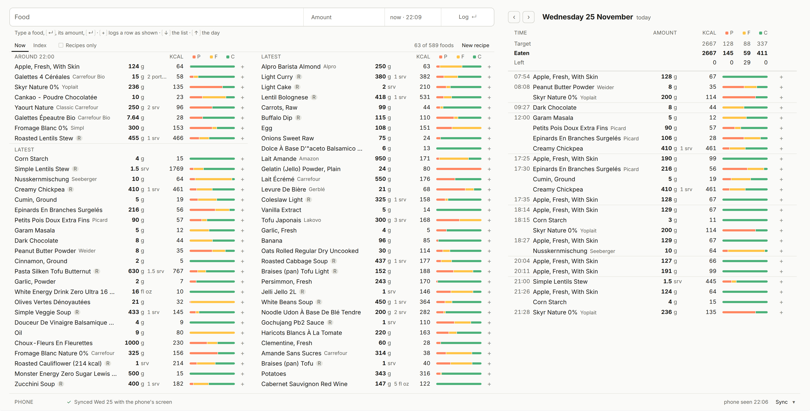

# MacroFactor from the desktop

Log, edit, and export food data in MacroFactor for Android from a browser or terminal. `mf` reads
from a local copy of your history and checks what the phone saved after each write.



## Getting started

Install `uv` and Android Platform Tools (`adb`). Connect your Android phone over USB with USB
debugging enabled, unlock it, and authorize the computer. Set MacroFactor to English and use a
24-hour clock.

```sh
uv sync
uv run mf status
uv run mf sync all
uv run mf serve
```

Open [the web UI](http://127.0.0.1:8377). The first sync imports your food history from the phone.
If you already have a MacroFactor Food Log CSV or workbook, you can load it with
`uv run mf import FILE` in place of that sync.

`mf` has no API to call: it reads MacroFactor's screens and taps them. It was written and is used daily
on one phone, a realme Note 70T (Android 16, 720 × 1600 screen) with MacroFactor 5.8.11. Another phone,
screen size or app version may show things it does not expect. Before trusting it with your log, check
that `uv run mf day --live` reads a day correctly and that `uv run mf log -n` finds your foods;
`uv run mf status` shows your phone's app version and screen beside those.

## Logging food

In the browser, type a food and press **Enter** to select it. Enter the amount and press **Enter**
again to log it. Click **+** on a food or a day entry to log the amount shown. Click an entry's
amount or time to edit it in place. Use **Undo** to reverse the last supported change.

From a terminal, try these commands with foods from your own history.

```sh
uv run mf log -n "apple 150g, skyr 200g @8:30"
uv run mf day yesterday
uv run mf --help
```

`-n` previews the log. Remove it to save. A food name on its own uses your usual serving.
Use `2 apple` for one entry at twice the usual amount, or `3x apple` for three separate entries.
Add a day such as `yesterday` at the end to log on that day.

`mf search` looks up ingredients in MacroFactor's database. Use `mf recipe try` to check quantities
and nutrition before creating a recipe. See `uv run mf recipe --help` for the ingredient syntax.

## Syncing and backups

- **Sync a day** with the browser's **Sync** button or `uv run mf sync [DAY]`. This reads the
  phone screen and picks up changes made in MacroFactor. It takes about 15 seconds.
- **Sync recipes** made or changed on the phone with **Recipes** in the menu beside Sync, or
  `uv run mf sync recipes`.
- **Import a range** with **Last 7 days** in that menu, or `uv run mf sync week`, `month`, or `all`.
  Each uses one MacroFactor export, which MacroFactor rations to a few a day.
- **Back up** with `uv run mf backup`. This saves a checksummed all-time food log CSV and workbook
  locally. It uses two exports. `uv run mf status` shows the remaining export allowance.

If a save is uncertain, use **Check** in the browser or sync the affected day, then review what
was saved. The food database and exports live in `~/.local/share/macrofactor/`. Traces and
phone diagnostics can contain food details and stay in `~/.local/state/mf/`.

## Development

```sh
uv run pytest -q
uv run ruff check .
```

The tests use synthetic data. Use `uv run python tools/sandbox.py` to try the browser UI with a
pretend phone. For changes to the Android driver, follow the real-phone validation steps in
[AGENTS.md](AGENTS.md).

[Web UI design](DESIGN.md) · [Android driver](PHONE.md)

[MIT licence](LICENSE). Not affiliated with MacroFactor.
